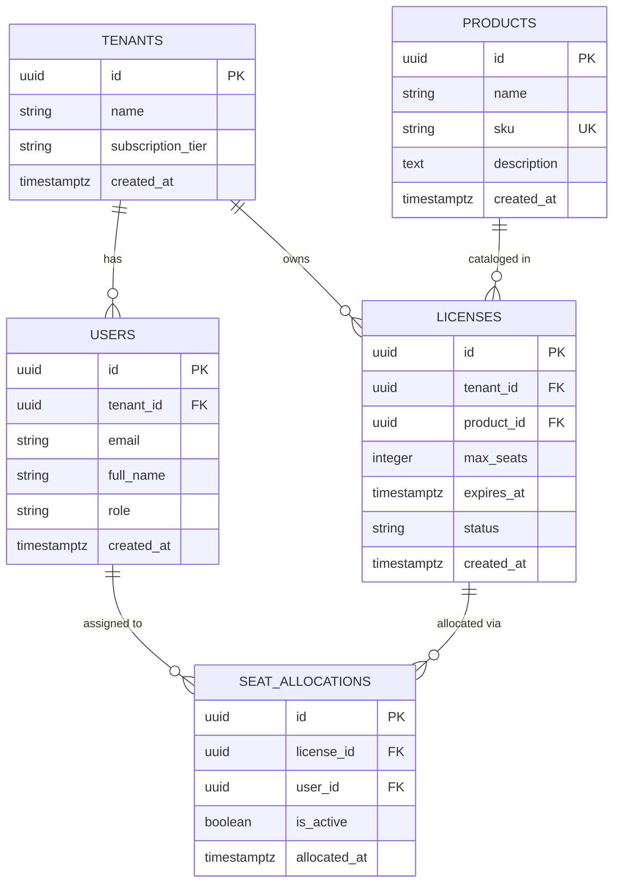

# Implementation Plan - Multi-Tenant Digital Asset & License Management System

Design and implementation architecture for a multi-tenant PostgreSQL database system enforcing 3rd Normal Form (3NF), Row-Level Security (RLS), concurrency-safe quota triggers, and transaction boundary verification.

## Architecture & System Overview



---

## User Review Required

> [!IMPORTANT]
> **Key Architectural Decisions Submitted for Review:**
> 1. **Primary Keys (UUID v4 vs. BIGINT):** UUID v4 (`gen_random_uuid()`) is proposed for primary keys to eliminate sequential ID enumeration risks across multi-tenant boundaries.
> 2. **Concurrency-Safe Quota Checks:** The seat allocation trigger will execute a `SELECT max_seats FROM licenses WHERE id = NEW.license_id FOR UPDATE` to lock the license row during quota check, avoiding race conditions during parallel seat assignment requests.
> 3. **RLS Context Switch Mechanism:** Tenant isolation relies on PostgreSQL's session-level configuration `SET LOCAL app.current_tenant_id = 'tenant-uuid'`. Tables will feature `FORCE ROW LEVEL SECURITY` to prevent bypass even for table owners.

---

## Proposed Database Architecture & Schema (3NF)

### 1. Entity Definitions & Constraints

- **`tenants`**
  - `id`: `UUID PRIMARY KEY DEFAULT gen_random_uuid()`
  - `name`: `VARCHAR(100) NOT NULL`
  - `subscription_tier`: `VARCHAR(50) NOT NULL CHECK (subscription_tier IN ('FREE', 'PRO', 'ENTERPRISE'))`
  - `created_at`: `TIMESTAMPTZ NOT NULL DEFAULT CURRENT_TIMESTAMP`

- **`products`** (Global catalog, tenant-agnostic)
  - `id`: `UUID PRIMARY KEY DEFAULT gen_random_uuid()`
  - `name`: `VARCHAR(100) NOT NULL`
  - `sku`: `VARCHAR(50) UNIQUE NOT NULL`
  - `description`: `TEXT`
  - `created_at`: `TIMESTAMPTZ NOT NULL DEFAULT CURRENT_TIMESTAMP`

- **`users`** (Tenant-scoped)
  - `id`: `UUID PRIMARY KEY DEFAULT gen_random_uuid()`
  - `tenant_id`: `UUID NOT NULL REFERENCES tenants(id) ON DELETE CASCADE`
  - `email`: `VARCHAR(255) NOT NULL`
  - `full_name`: `VARCHAR(100) NOT NULL`
  - `role`: `VARCHAR(20) NOT NULL CHECK (role IN ('Admin', 'Member'))`
  - `created_at`: `TIMESTAMPTZ NOT NULL DEFAULT CURRENT_TIMESTAMP`
  - *Constraint:* `UNIQUE (tenant_id, email)`

- **`licenses`** (Tenant-scoped)
  - `id`: `UUID PRIMARY KEY DEFAULT gen_random_uuid()`
  - `tenant_id`: `UUID NOT NULL REFERENCES tenants(id) ON DELETE CASCADE`
  - `product_id`: `UUID NOT NULL REFERENCES products(id) ON DELETE RESTRICT`
  - `max_seats`: `INTEGER NOT NULL CHECK (max_seats > 0)`
  - `expires_at`: `TIMESTAMPTZ NOT NULL`
  - `status`: `VARCHAR(20) NOT NULL CHECK (status IN ('ACTIVE', 'EXPIRED', 'SUSPENDED')) DEFAULT 'ACTIVE'`
  - `created_at`: `TIMESTAMPTZ NOT NULL DEFAULT CURRENT_TIMESTAMP`

- **`seat_allocations`** (Tenant-scoped junction table)
  - `id`: `UUID PRIMARY KEY DEFAULT gen_random_uuid()`
  - `license_id`: `UUID NOT NULL REFERENCES licenses(id) ON DELETE CASCADE`
  - `user_id`: `UUID NOT NULL REFERENCES users(id) ON DELETE CASCADE`
  - `is_active`: `BOOLEAN NOT NULL DEFAULT TRUE`
  - `allocated_at`: `TIMESTAMPTZ NOT NULL DEFAULT CURRENT_TIMESTAMP`
  - *Constraint:* `UNIQUE (license_id, user_id)` (A user cannot be allocated to the same license multiple times)

---

## Strict Tenant Isolation (Row-Level Security)

### RLS Helper Function & Policies
RLS policies will use `NULLIF(current_setting('app.current_tenant_id', true), '')::uuid` to inspect session variable.

1. **`users` Policy:**
   ```sql
   ALTER TABLE users ENABLE ROW LEVEL SECURITY;
   ALTER TABLE users FORCE ROW LEVEL SECURITY;

   CREATE POLICY tenant_isolation_users ON users
     USING (tenant_id = NULLIF(current_setting('app.current_tenant_id', true), '')::uuid);
   ```

2. **`licenses` Policy:**
   ```sql
   ALTER TABLE licenses ENABLE ROW LEVEL SECURITY;
   ALTER TABLE licenses FORCE ROW LEVEL SECURITY;

   CREATE POLICY tenant_isolation_licenses ON licenses
     USING (tenant_id = NULLIF(current_setting('app.current_tenant_id', true), '')::uuid);
   ```

3. **`seat_allocations` Policy:**
   ```sql
   ALTER TABLE seat_allocations ENABLE ROW LEVEL SECURITY;
   ALTER TABLE seat_allocations FORCE ROW LEVEL SECURITY;

   CREATE POLICY tenant_isolation_seat_allocations ON seat_allocations
     USING (
       EXISTS (
         SELECT 1 FROM licenses l
         WHERE l.id = seat_allocations.license_id
           AND l.tenant_id = NULLIF(current_setting('app.current_tenant_id', true), '')::uuid
       )
     );
   ```

---

## Database-Enforced Business Rules (PL/pgSQL Triggers & Procedures)

### 1. Seat Quota & Tenant Integrity Trigger (`fn_enforce_seat_allocation_limits`)
- **Trigger event:** `BEFORE INSERT OR UPDATE ON seat_allocations`
- **Validation logic:**
  1. Check if `user_id` belongs to the same tenant as `license_id`. If tenant mismatch, `RAISE EXCEPTION 'Cross-tenant seat allocation prohibited'`.
  2. If `NEW.is_active = TRUE`:
     - Lock the license record: `SELECT max_seats, status, expires_at FROM licenses WHERE id = NEW.license_id FOR UPDATE`.
     - Check if license status is `'ACTIVE'` and not expired (`expires_at > CURRENT_TIMESTAMP`). If not, `RAISE EXCEPTION 'Cannot allocate seat to an inactive or expired license'`.
     - Count active seats: `SELECT COUNT(*) FROM seat_allocations WHERE license_id = NEW.license_id AND is_active = TRUE AND id IS DISTINCT FROM NEW.id`.
     - Compare `current_active_seats + 1` with `max_seats`.
     - If count exceeds `max_seats`, `RAISE EXCEPTION 'Seat quota exceeded for License ID %. Max allowed: %, Current active: %'`.

### 2. Automated License Status Updater (`sp_update_license_statuses`)
- Stored procedure to batch process licenses:
  - Updates licenses with `expires_at <= CURRENT_TIMESTAMP` and `status = 'ACTIVE'` to `'EXPIRED'`.
  - Can be called manually or scheduled via cron/pg_cron.
  - Includes a view `v_active_licenses` that dynamically filters out expired licenses in real time.

---

## Project Structure & File Deliverables

- **`init_schema.sql`**: Full DDL setup script (Enums, Tables, FKs, Indexes, RLS Policies, Triggers, Functions, Views).
- **`seed_data.sql`**: Initial realistic dataset:
  - 3 Products (e.g. Enterprise Suite, Analytics Pro, Cloud Storage).
  - 2 Tenants:
    - **Tenant A (Acme Corp)**: PRO tier, 5-seat quota license.
    - **Tenant B (Beta LLC)**: FREE tier, 2-seat quota license.
  - Realistic Users and initial Seat Allocations for both tenants.
- **`test_enforcement.sql`**: Verification harness executing test cases in transaction blocks with `ROLLBACK`/`COMMIT` to prove enforcement.

---

## Verification Plan

### Automated Test Suite (`test_enforcement.sql`)
1. **Test 1: Seat Quota Exceeded (Tenant B - 2 Seat Limit)**
   - Set context to Tenant B.
   - Insert 2 seat allocations (Succeeds).
   - Attempt 3rd seat allocation -> Must throw exception: `Seat quota exceeded`.
2. **Test 2: Cross-Tenant Data Isolation (RLS Verification)**
   - Set context to Tenant A (`SET LOCAL app.current_tenant_id = 'tenant-a-uuid'`).
   - Query `users`, `licenses`, `seat_allocations` -> Must return ONLY Tenant A records.
   - Switch context to Tenant B (`SET LOCAL app.current_tenant_id = 'tenant-b-uuid'`).
   - Query tables -> Must return ONLY Tenant B records.
3. **Test 3: Cross-Tenant Seat Assignment Violation**
   - Attempt to allocate Tenant A user to Tenant B license -> Must throw exception: `Cross-tenant seat allocation prohibited`.
4. **Test 4: Expired License Allocation Blocking**
   - Attempt to allocate seat on an expired license -> Must throw exception: `Cannot allocate seat to an inactive or expired license`.
5. **Test 5: License Status Auto-Update Procedure**
   - Execute `CALL sp_update_license_statuses()`.
   - Verify that licenses past expiration timestamp transition to `'EXPIRED'`.

---

## Open Questions

> [!NOTE]
> 1. Do you prefer PostgreSQL's `uuid-ossp` / built-in `gen_random_uuid()` for IDs, or `BIGSERIAL` integer IDs? (Defaulting to `gen_random_uuid()`).
> 2. Should we also create a README or documentation file explaining how to run these scripts on a standard PostgreSQL instance (e.g. via `psql` or pgAdmin)?
